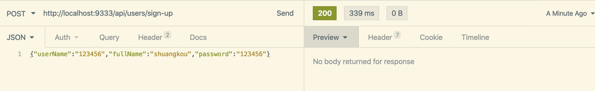
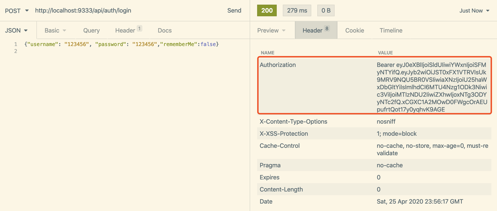
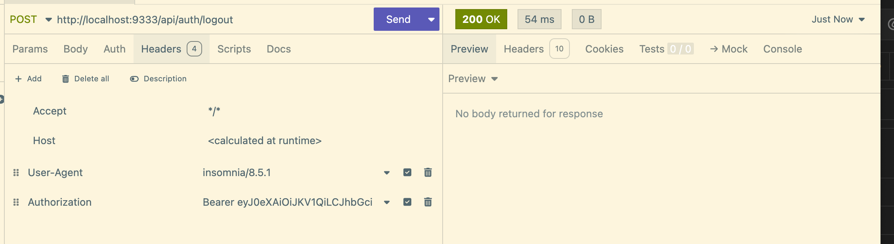
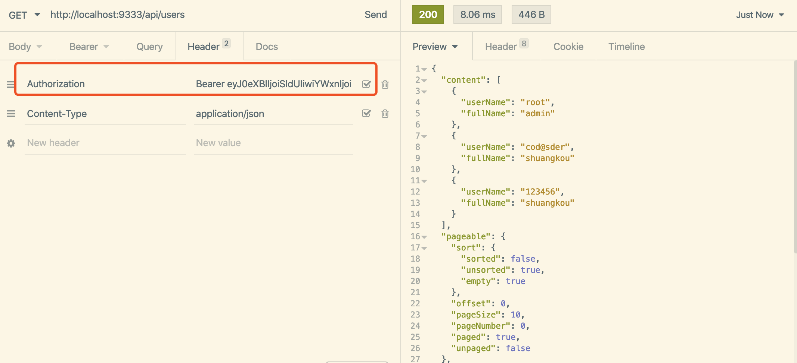
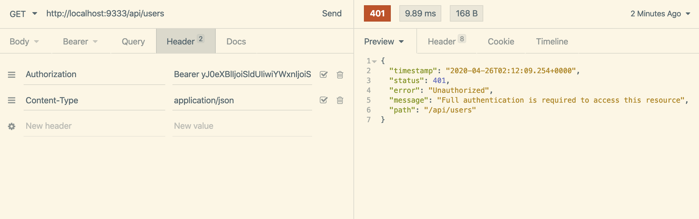
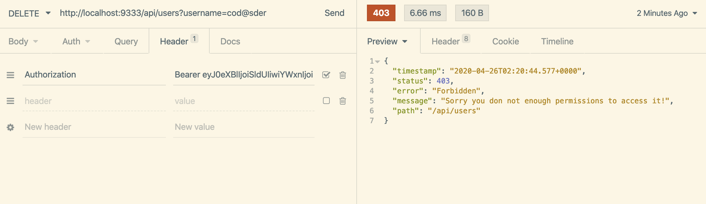

# RudyPP

A demo project for **stateless JWT authentication and role-based authorization** with Spring Boot and Spring Security. It covers sign-up, login, logout, token revocation through Redis, method-level permission checks and JPA auditing, and it comes with a simple login page.

## Tech Stack

| Area        | Technology                                |
| ----------- | ----------------------------------------- |
| Language    | Java 25                                   |
| Framework   | Spring Boot 3.5.0                         |
| Security    | Spring Security 6.5, JJWT 0.12.3          |
| Persistence | Spring Data JPA, MySQL 8 (H2 for tests)   |
| Cache       | Redis (Lettuce + commons-pool2)           |
| Other       | Lombok, Guava, Bean Validation            |
| Build       | Maven                                     |

## Features

- **JWT login/logout**: login returns a token. Send it as `Authorization: Bearer <token>`.
- **Token lifetime**: tokens last 1 hour by default, or 7 days when `rememberMe` is set.
- **Token revocation**: Redis stores the active token for each user. Logging out deletes it, and logging in again replaces it, so old tokens stop working right away.
- **Roles**: `USER`, `TEMP_USER`, `MANAGER` and `ADMIN`. Users and roles are linked through a `user_role` join table, and endpoints are protected with `@PreAuthorize`.
- **JPA auditing**: entities record who created or changed them, and when (`AbstractAuditBase`).
- **Unified errors**: a global exception handler returns error responses in one consistent format.
- **Login page**: a static login, sign-up and home page served by the app.

## Project Structure

```
src/main/java/com/rudypp
├── RudyPPApplication.java   # Entry point
├── security                 # JWT filter, security config, auth controller/service
│   ├── config / filter / exception / utils / constants
│   └── web                  # /auth endpoints
└── system                   # Users, roles, auditing, Redis config, validation
    ├── entity / repository / service / enums / validator / exception
    └── web                  # /users endpoints
src/main/resources
├── application.yaml         # Shared settings + local MySQL/Redis defaults
├── application-prod.yaml    # Production (EC2) overrides, all secrets from env vars
└── static/                  # Login & home pages (HTML/CSS/JS)
scripts/mysql-init.sql       # Creates the database, app user, tables and initial data
```

## Getting Started

### Prerequisites

- JDK 25
- Maven 3.9+
- A Redis server on `127.0.0.1:6379`. It's required, because tokens are stored in Redis.
- MySQL 8 on `localhost:3306`.

### Set up MySQL

Create the database and the app user once, as the MySQL root user:

```bash
mysql -u root -p < scripts/mysql-init.sql
```

This creates the `rudypp` database and a `rudypp` / `rudypp` user, which match the local defaults in `application.yaml`. It also creates the tables and the initial data: the four roles and the admin account `root` / `root`. It's safe to run again; rows that already exist are skipped.

### Run

```bash
mvn spring-boot:run
```

The app starts at **http://localhost:9333/api/** and opens it in your default browser. To stop the browser from opening, set `app.open-browser: false` in `application.yaml` or `APP_OPEN_BROWSER=false`.

In VS Code, you can use the **RudyPPApplication** launch configuration in `.vscode/launch.json`. Its environment variables override `application.yaml`.

### Defaults

| What                | Value                                                         |
| ------------------- | ------------------------------------------------------------- |
| Admin account       | `root` / `root`                                               |
| MySQL               | `localhost:3306/rudypp`, user `rudypp` / `rudypp`             |
| JWT signing key     | Set via the `JWT_SECRET_KEY` env var. A dev-only fallback is built in. |

Database tables are created and updated automatically on startup (`ddl-auto: update`).

### Configuration

All database settings can be overridden with environment variables:

| Variable        | Default (local) | Notes                                             |
| --------------- | --------------- | ------------------------------------------------- |
| `DB_HOST`       | `localhost`     | Required in `prod`                                |
| `DB_PORT`       | `3306`          |                                                   |
| `DB_NAME`       | `rudypp`        | Required in `prod`                                |
| `DB_USERNAME`   | `rudypp`        | Required in `prod`                                |
| `DB_PASSWORD`   | `rudypp`        | Required in `prod`                                |
| `DB_SSL_MODE`   | `REQUIRED`      | `prod` only. Use `DISABLED` for MySQL on the same host without TLS |
| `DB_POOL_SIZE`  | `10`            | Maximum number of connections in the pool         |
| `JPA_DDL_AUTO`  | `update`        | Set to `validate` once schema migrations are in place |

### Tests

```bash
mvn test
```

The tests use an H2 in-memory database in MySQL mode, so they don't need MySQL. Some tests need Redis to be running.

## Deploying to AWS EC2

1. **Database**: either install MySQL 8 on the instance and run `scripts/mysql-init.sql` with a strong password, or create an RDS MySQL instance. With RDS, allow port 3306 from the EC2 security group only.
2. **Build** the jar with `mvn clean package -DskipTests` and copy `target/rudypp-0.0.1-SNAPSHOT.jar` to the instance.
3. **Configure** the environment. For example, put this in `/etc/rudypp/rudypp.env`, owned by root with `chmod 600`:

   ```bash
   SPRING_PROFILES_ACTIVE=prod
   DB_HOST=localhost            # or the RDS endpoint
   DB_NAME=rudypp
   DB_USERNAME=rudypp
   DB_PASSWORD=change-me
   DB_SSL_MODE=DISABLED         # only for MySQL on the same host without TLS
   REDIS_HOST=localhost
   JWT_SECRET_KEY=a-random-string-of-at-least-32-bytes
   ```

4. **Run** the app, for example as a systemd service with `EnvironmentFile=/etc/rudypp/rudypp.env` and `ExecStart=/usr/bin/java -jar /opt/rudypp/rudypp.jar`.

The `prod` profile turns off SQL logging and the browser launcher. If any of the required `DB_*` variables is missing, the app refuses to start.

## API

All paths are relative to `http://localhost:9333/api`.

| Method   | Path                    | Access                          | Description                         |
| -------- | ----------------------- | ------------------------------- | ----------------------------------- |
| `POST`   | `/users/sign-up`        | Public                          | Register (new users get `USER` + `MANAGER`) |
| `POST`   | `/auth/login`           | Public                          | Log in, returns a JWT               |
| `POST`   | `/auth/logout`          | Authenticated                   | Log out and revoke the token        |
| `GET`    | `/users`                | `USER`, `MANAGER`, `ADMIN`      | List users (paged)                  |
| `PUT`    | `/users`                | `ADMIN`                         | Update a user                       |
| `DELETE` | `/users?username=xxx`   | `ADMIN`                         | Delete a user                       |

### Examples

**Sign up**

```http
POST /api/users/sign-up
Content-Type: application/json

{ "userName": "123456", "fullName": "shuangkou", "password": "123456" }
```

`fullName` must be 2–15 characters long. It can contain Chinese characters, letters or digits, but it can't be all digits.



**Login**

```http
POST /api/auth/login
Content-Type: application/json

{ "username": "123456", "password": "123456", "rememberMe": true }
```



**Logout**



**Accessing a protected resource with a valid token**



**Missing or invalid token** returns `401`:



**Valid token but not enough permission** (for example, a non-admin calling `DELETE /users`) returns `403`:



## Further Reading

- [docs/spring-security-introduction.md](./docs/spring-security-introduction.md): an introduction to Spring Security and JWT authentication
- [docs/spring-security-implementation.md](./docs/spring-security-implementation.md): the original project write-up (partly out of date)

## Author

**Rudy Lyu** (lvdiboy@gmail.com)
